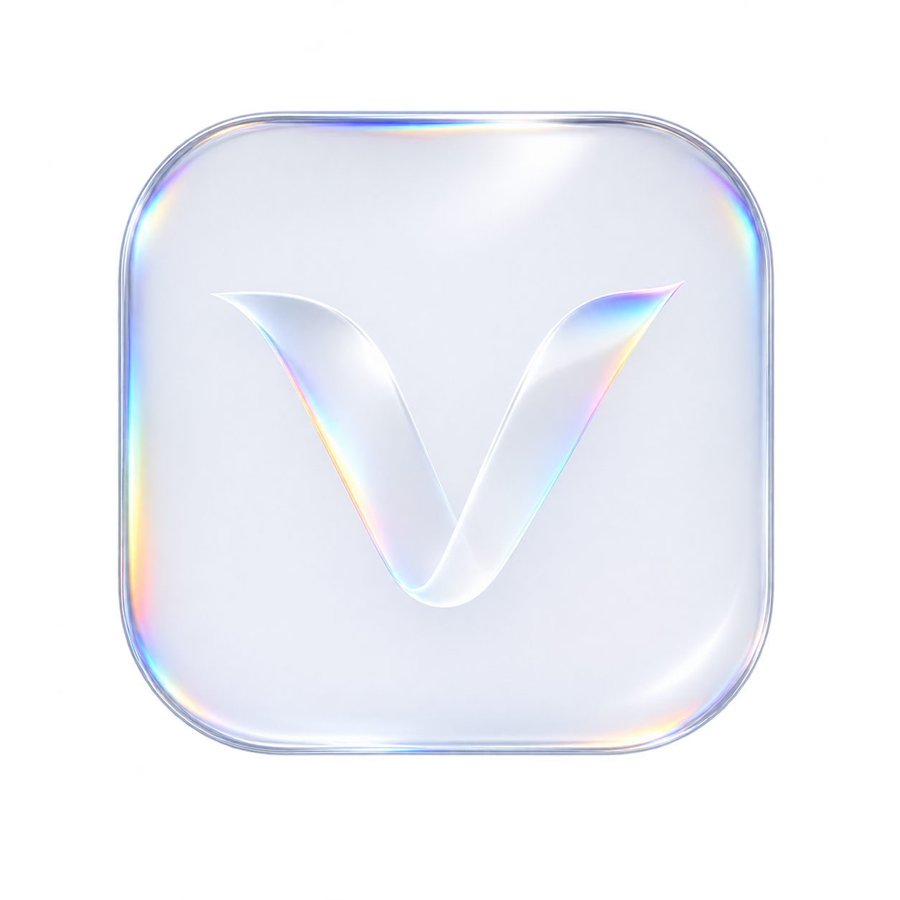

<div align="center">

<h1>Veyra</h1>



<p>让应用、文件与音乐，轻盈地融入桌面。</p>

<p>采用 Liquid Glass 材质的 Windows 桌面工具<br>Dock · 右侧控制中心 · 映射收纳盒 · 音乐灵动岛</p>

<p>
  <a href="https://github.com/M1vvl/Veyra/releases/latest">下载 Windows 版</a> ·
  <a href="https://github.com/M1vvl/Veyra/releases/download/v1.0.3/Veyra.exe">直接下载 1.0.3 EXE</a> ·
  <a href="docs/BUILD.md">构建指南</a> ·
  <a href="https://github.com/M1vvl/Veyra/issues">问题反馈</a>
</p>

</div>

## 支持平台

Windows 11 x64。发布版为自带 .NET 运行时的单文件 EXE，下载后双击运行，首次启动会自动展开依赖并短暂等待。

## 功能

| 模块 | 功能 |
| --- | --- |
| Dock | 拖入应用、识别运行窗口与磁吸放大，玻璃底框随图标动态伸展。 |
| 右侧状态栏与控制中心 | 调整音量、亮度和网络，切换输入法，查看日历与隐藏托盘；支持自动隐藏、固定和始终置顶。 |
| 映射收纳盒 | 引用文件与文件夹的原始位置，支持独立命名、拖放排序、分组隐藏与固定、网格缩放，收起后同列自动补位。 |
| 音乐灵动岛 | 显示旋转封面、律动条、逐字歌词与播放进度，支持展开过渡及网易云、QQ 音乐本机后台适配。 |
| 外观与配色 | 调整玻璃透明度、Dock 尺寸、图标大小、磁吸和材质刷新率；歌词、进度条、律动条可独立选择颜色，提供默认设置。 |
| 桌面与资源管理 | 最大化或全屏应用覆盖桌面时暂停相关渲染，返回后恢复；关闭灵动岛会停止媒体读取并释放专用资源。 |

网络页将已连接 Wi-Fi 置顶，其余附近网络按信号强度排列，并显示以太网连接。附近 Wi-Fi 扫描需要 Windows 位置访问权限，受限时可从网络页进入授权设置。音乐进度拖动需要播放器支持系统媒体定位接口，后台识别效果取决于播放器提供的信息与版本。

## 下载

在 [Releases](https://github.com/M1vvl/Veyra/releases/latest) 的 Assets 中下载 `Veyra.exe`，保存到自己的文件夹后双击运行。同时下载并解压 `Veyra-1.0.3-Licenses.zip`，保存随附的第三方许可；`SHA256SUMS.txt` 提供文件校验值。

完整开发源码位于仓库 Code 页面，各发布页也提供对应版本的 Source code 下载。

## 使用

启动后，通过 Veyra 托盘菜单打开设置。桌面应用、文件与文件夹可拖入 Dock 或收纳盒。

设置和映射引用保存在本机用户目录 `%LOCALAPPDATA%\GlassDock`，兼容早期版本。收纳盒保留源文件位置。退出 Veyra 时恢复 Windows 任务栏。需要手动恢复时运行以下命令。

```powershell
.\Veyra.exe --restore-taskbar
```

## 开发与构建

主程序使用 C#、WPF 与 Direct3D 11，源码按桌面交互、收纳、媒体和材质渲染模块组织。构建需要 Windows 和 .NET 8 SDK，在源码根目录运行以下命令。

```powershell
powershell -ExecutionPolicy Bypass -File .\build.ps1
```

输出文件为 `dist\Veyra.exe`。完整构建说明见 [docs/BUILD.md](docs/BUILD.md)。

## 免责声明

本项目自有代码沿用仓库的 MIT 许可。第三方组件分别遵循各自许可，详见 [LICENSE](LICENSE)、[THIRD_PARTY_NOTICES.md](THIRD_PARTY_NOTICES.md) 和 [licenses](licenses)。

收纳盒吸附几何适配自 WitchDrawer，其相关代码遵循 PolyForm Noncommercial 1.0.1。包含该组件的分发与使用须遵守其非商业许可及 Required Notice，具体条款见 [WitchDrawer 许可](src/Veyra/ThirdParty/WitchDrawer/LICENSE.txt) 与 [版权说明](src/Veyra/ThirdParty/WitchDrawer/NOTICE.md)。

本软件按现状提供。在适用法律允许的范围内，作者和贡献者不对其适用性、可靠性或准确性作出明示或暗示的保证，也不承担使用本软件产生的损失责任。使用者应遵守所在地法律及相关第三方许可。

## 隐私政策

Veyra 当前版本不包含用户数据收集、遥测或自动上传模块。偏好、Dock 固定项、收纳盒路径引用和诊断日志保存在本机用户目录。

音量、亮度、输入法、网络与托盘功能通过本机 Windows 接口交互。使用网络连接或打开第三方应用时，相关通信与数据处理受 Windows、网络服务及对应应用的隐私政策约束。

启用音乐灵动岛后，组件通过 Windows 媒体会话读取播放信息。网易云后台时间轴缺失时，在本机以只读方式识别播放进度。歌词优先读取本地 LRC，随后按歌曲 ID、标题或歌手向网易云、QQ 音乐接口查询，相关服务会收到查询内容。关闭灵动岛后停止这些读取和请求。

开发构建需要从 NuGet 获取依赖，独立光学核对场景的构建需要 npm 依赖。
